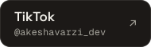
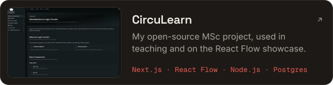
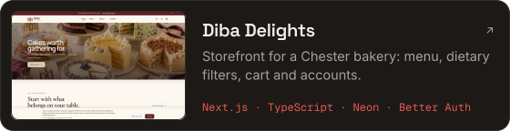
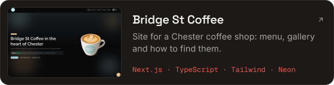
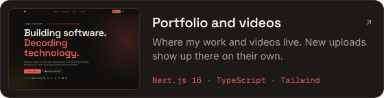
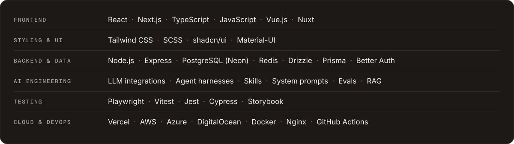

<a href="https://amin-keshavarzi.com"><picture><source media="(prefers-color-scheme: dark)" srcset="assets/profile/banner-dark.svg"><source media="(prefers-color-scheme: light)" srcset="assets/profile/banner-light.svg"></picture></a>

Hey, I'm Amin, a full-stack engineer in Chester, UK, currently a frontend engineer at Keystone Education Group. I also make short videos as **@amin_decodes**, each one an everyday job in a TypeScript, React or Next.js project done better with an agent.

  <a href="https://www.youtube.com/@amin_decodes?sub_confirmation=1"><picture><source media="(prefers-color-scheme: dark)" srcset="assets/profile/btn-youtube-dark.svg"><source media="(prefers-color-scheme: light)" srcset="assets/profile/btn-youtube-light.svg"></picture></a>
  <a href="https://www.instagram.com/amin_decodes/"><picture><source media="(prefers-color-scheme: dark)" srcset="assets/profile/btn-instagram-dark.svg"><source media="(prefers-color-scheme: light)" srcset="assets/profile/btn-instagram-light.svg"></picture></a>
  <a href="https://www.tiktok.com/@akeshavarzi_dev"><picture><source media="(prefers-color-scheme: dark)" srcset="assets/profile/btn-tiktok-dark.svg"><source media="(prefers-color-scheme: light)" srcset="assets/profile/btn-tiktok-light.svg"></picture></a>
  <a href="https://x.com/amin_decodes"><picture><source media="(prefers-color-scheme: dark)" srcset="assets/profile/btn-x-dark.svg"><source media="(prefers-color-scheme: light)" srcset="assets/profile/btn-x-light.svg"></picture></a>
  <a href="https://www.threads.com/@amin_decodes"><picture><source media="(prefers-color-scheme: dark)" srcset="assets/profile/btn-threads-dark.svg"><source media="(prefers-color-scheme: light)" srcset="assets/profile/btn-threads-light.svg"></picture></a>
  <a href="https://www.linkedin.com/in/amin-keshavarzi/"><picture><source media="(prefers-color-scheme: dark)" srcset="assets/profile/btn-linkedin-dark.svg"><source media="(prefers-color-scheme: light)" srcset="assets/profile/btn-linkedin-light.svg"></picture></a>
  <a href="https://amin-keshavarzi.com"><picture><source media="(prefers-color-scheme: dark)" srcset="assets/profile/btn-website-dark.svg"><source media="(prefers-color-scheme: light)" srcset="assets/profile/btn-website-light.svg"></picture></a>

<h3><picture><source media="(prefers-color-scheme: dark)" srcset="assets/profile/h-videos-dark.svg"><source media="(prefers-color-scheme: light)" srcset="assets/profile/h-videos-light.svg"></picture></h3>

<!-- videos:start -->
<<<<<<< Updated upstream

[Your Next.js links load pages before you click](https://www.youtube.com/shorts/lDNf4BrbjJM) · [All videos](https://amin-keshavarzi.com/videos)
=======
The first videos are on the way. [Subscribe on YouTube](https://www.youtube.com/@amin_decodes?sub_confirmation=1) and they'll land in your feed.
>>>>>>> Stashed changes
<!-- videos:end -->

<h3><picture><source media="(prefers-color-scheme: dark)" srcset="assets/profile/h-work-dark.svg"><source media="(prefers-color-scheme: light)" srcset="assets/profile/h-work-light.svg"></picture></h3>

  <a href="https://circulearn.co.uk"><picture><source media="(prefers-color-scheme: dark)" srcset="assets/profile/card-circulearn-dark.svg"><source media="(prefers-color-scheme: light)" srcset="assets/profile/card-circulearn-light.svg"></picture></a>
  <a href="https://diba-delights.co.uk"><picture><source media="(prefers-color-scheme: dark)" srcset="assets/profile/card-diba-delights-dark.svg"><source media="(prefers-color-scheme: light)" srcset="assets/profile/card-diba-delights-light.svg"></picture></a>
  <a href="https://www.bridgestcoffee.co.uk"><picture><source media="(prefers-color-scheme: dark)" srcset="assets/profile/card-bridge-st-coffee-dark.svg"><source media="(prefers-color-scheme: light)" srcset="assets/profile/card-bridge-st-coffee-light.svg"></picture></a>
  <a href="https://amin-keshavarzi.com"><picture><source media="(prefers-color-scheme: dark)" srcset="assets/profile/card-portfolio-dark.svg"><source media="(prefers-color-scheme: light)" srcset="assets/profile/card-portfolio-light.svg"></picture></a>

<picture><source media="(prefers-color-scheme: dark)" srcset="assets/profile/toolbox-dark.svg"><source media="(prefers-color-scheme: light)" srcset="assets/profile/toolbox-light.svg"></picture>
