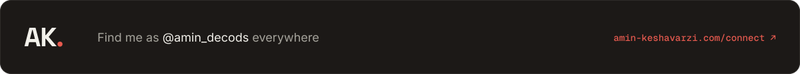

<a href="https://amin-keshavarzi.com">
  <picture>
    <source media="(prefers-color-scheme: dark)" srcset="assets/profile/banner-dark.svg">
    <source media="(prefers-color-scheme: light)" srcset="assets/profile/banner-light.svg">
    
  </picture>
</a>

Hey, I'm Amin. I'm a full-stack software engineer in Chester, UK, and I've been building web apps for 6+ years, mostly React and Next.js up front, Node and Postgres behind it, and more and more AI features lately.

By day I'm a frontend engineer at Keystone Education Group, where I've shipped an analytics dashboard for institutions and an AI advisor that helps students find the right course on educations.com.

I also make short videos as **@amin_decods**. Each one takes an everyday job in a TypeScript, React or Next.js project and shows a better way to do it with an agent: the setup, the exact prompt, and what you actually get.

  <a href="https://www.youtube.com/@amin_decods?sub_confirmation=1"><picture><source media="(prefers-color-scheme: dark)" srcset="assets/profile/btn-youtube-dark.svg"><source media="(prefers-color-scheme: light)" srcset="assets/profile/btn-youtube-light.svg"></picture></a>
  <a href="https://www.instagram.com/amin_decods/"><picture><source media="(prefers-color-scheme: dark)" srcset="assets/profile/btn-instagram-dark.svg"><source media="(prefers-color-scheme: light)" srcset="assets/profile/btn-instagram-light.svg"></picture></a>
  <a href="https://www.tiktok.com/@akeshavarzi_dev"><picture><source media="(prefers-color-scheme: dark)" srcset="assets/profile/btn-tiktok-dark.svg"><source media="(prefers-color-scheme: light)" srcset="assets/profile/btn-tiktok-light.svg"></picture></a>
  <a href="https://x.com/amin_decods"><picture><source media="(prefers-color-scheme: dark)" srcset="assets/profile/btn-x-dark.svg"><source media="(prefers-color-scheme: light)" srcset="assets/profile/btn-x-light.svg"></picture></a>
  <a href="https://www.threads.com/@amin_decods"><picture><source media="(prefers-color-scheme: dark)" srcset="assets/profile/btn-threads-dark.svg"><source media="(prefers-color-scheme: light)" srcset="assets/profile/btn-threads-light.svg"></picture></a>
  <a href="https://www.linkedin.com/in/amin-keshavarzi/"><picture><source media="(prefers-color-scheme: dark)" srcset="assets/profile/btn-linkedin-dark.svg"><source media="(prefers-color-scheme: light)" srcset="assets/profile/btn-linkedin-light.svg"></picture></a>
  <a href="https://amin-keshavarzi.com"><picture><source media="(prefers-color-scheme: dark)" srcset="assets/profile/btn-website-dark.svg"><source media="(prefers-color-scheme: light)" srcset="assets/profile/btn-website-light.svg"></picture></a>

<h2><picture><source media="(prefers-color-scheme: dark)" srcset="assets/profile/h-videos-dark.svg"><source media="(prefers-color-scheme: light)" srcset="assets/profile/h-videos-light.svg"></picture></h2>

<!-- videos:start -->
The first videos are on the way. [Subscribe on YouTube](https://www.youtube.com/@amin_decods?sub_confirmation=1) and they'll land in your feed.
<!-- videos:end -->

<h2><picture><source media="(prefers-color-scheme: dark)" srcset="assets/profile/h-work-dark.svg"><source media="(prefers-color-scheme: light)" srcset="assets/profile/h-work-light.svg"></picture></h2>

  <a href="https://circulearn.co.uk"><picture><source media="(prefers-color-scheme: dark)" srcset="assets/profile/card-circulearn-dark.svg"><source media="(prefers-color-scheme: light)" srcset="assets/profile/card-circulearn-light.svg"></picture></a>
  <a href="https://diba-delights.co.uk"><picture><source media="(prefers-color-scheme: dark)" srcset="assets/profile/card-diba-delights-dark.svg"><source media="(prefers-color-scheme: light)" srcset="assets/profile/card-diba-delights-light.svg"></picture></a>
  <a href="https://www.bridgestcoffee.co.uk"><picture><source media="(prefers-color-scheme: dark)" srcset="assets/profile/card-bridge-st-coffee-dark.svg"><source media="(prefers-color-scheme: light)" srcset="assets/profile/card-bridge-st-coffee-light.svg"></picture></a>
  <a href="https://amin-keshavarzi.com"><picture><source media="(prefers-color-scheme: dark)" srcset="assets/profile/card-portfolio-dark.svg"><source media="(prefers-color-scheme: light)" srcset="assets/profile/card-portfolio-light.svg"></picture></a>

CircuLearn's code is [right here on GitHub](https://github.com/amin0075/CircuLearn), and there's more of my work on [amin-keshavarzi.com](https://amin-keshavarzi.com/#projects).

<h2><picture><source media="(prefers-color-scheme: dark)" srcset="assets/profile/h-toolbox-dark.svg"><source media="(prefers-color-scheme: light)" srcset="assets/profile/h-toolbox-light.svg"></picture></h2>

<picture>
  <source media="(prefers-color-scheme: dark)" srcset="assets/profile/toolbox-dark.svg">
  <source media="(prefers-color-scheme: light)" srcset="assets/profile/toolbox-light.svg">
  
</picture>

  

<a href="https://amin-keshavarzi.com/connect">
  <picture>
    <source media="(prefers-color-scheme: dark)" srcset="assets/profile/footer-dark.svg">
    <source media="(prefers-color-scheme: light)" srcset="assets/profile/footer-light.svg">
    
  </picture>
</a>
